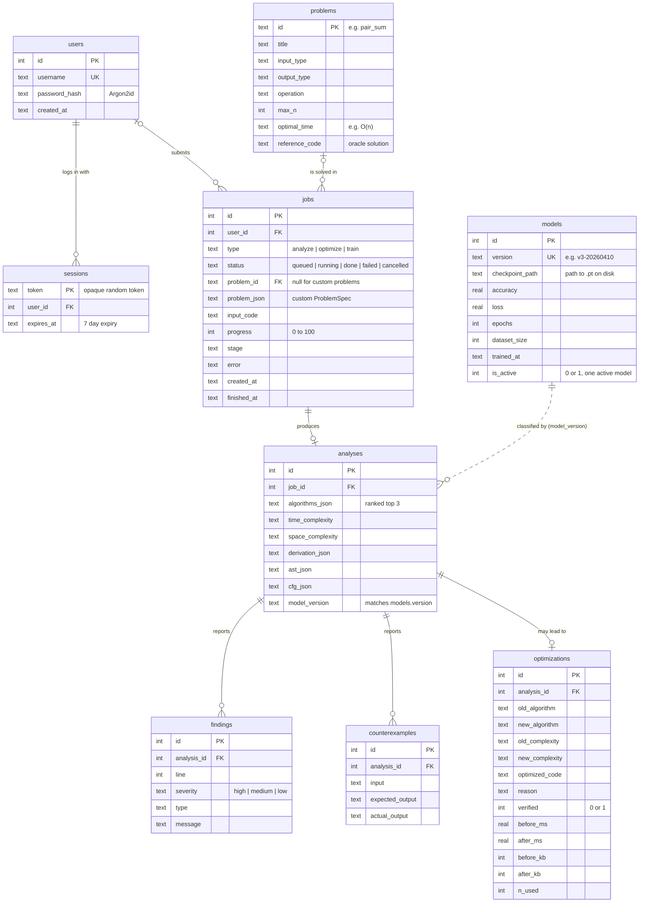

# NeuroCode Data Model (ERD)

Source of truth: `docs/architecture.md` section 6. This diagram mirrors that schema.
SQLite stores rows; large artifacts (`.pt` checkpoints, datasets, compiled binaries) live on disk and only their paths are stored.

## How to read it

| Symbol | Meaning |
|---|---|
| `\|\|--o{` | one to zero-or-many |
| `\|o--o{` | zero-or-one to zero-or-many (the foreign key may be null) |
| `\|\|--o\|` | one to zero-or-one |
| dotted line | linked by value, not by a foreign key |

## Relationships

| From | To | Cardinality | Notes |
|---|---|---|---|
| users | sessions | 1 to many | One user can be logged in on several devices |
| users | jobs | 0..1 to many | `user_id` may be null if auth is skipped (hardcoded user) |
| problems | jobs | 0..1 to many | `problem_id` is null when the user describes a custom problem in `problem_json` |
| jobs | analyses | 1 to 0..1 | analyze and optimize jobs produce one analysis; train jobs produce none |
| analyses | findings | 1 to many | Static check results |
| analyses | counterexamples | 1 to many | Differential testing mismatches |
| analyses | optimizations | 1 to 0..1 | Only when an optimization was found and verified |
| models | analyses | 1 to many | By value: `analyses.model_version` stores `models.version`, so old analyses keep their record even if a model row is removed |

## Open points for T3

1. **`optimizations` is missing the summary.** `OptimizationSummary` in `engine/IEngine.hpp` has `headline`, `explanation`, `comparison`, `changes`, `tradeoff`, `verification` and `speedup`. None of these have a column. Simplest fix: add one `summary_json TEXT` column.
2. **No link from a training job to the model it produced.** If the History or Training page should show "job 42 produced model v3", add `job_id INTEGER REFERENCES jobs(id)` to `models`.
3. **`jobs ||--o| analyses` is a rule, not enforced.** The schema allows several analyses per job. Add `UNIQUE` on `analyses.job_id` if exactly one is intended.
4. **Shortcut for week 2:** storing the whole `AnalysisResult` as one `result_json` column on `jobs` is enough to make the API work. The normalized tables above can be filled in later without changing the API.
